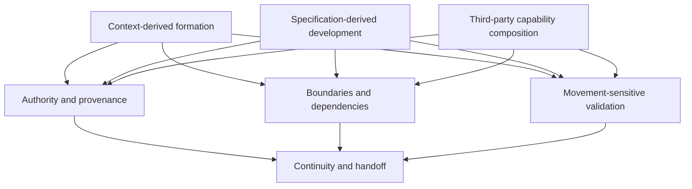

# Collection-Level Development Model

**Status:** Provisional working model. The three movements below are grounded in the current project understanding, but they are not an exhaustive taxonomy or an approved ontology.

## 1. Purpose and scope

`skills-development` provides a shared home for developing and maintaining a collection of agent skills whose origins and governing authorities can differ. It preserves common development discipline without forcing every skill through the same production method.

This repository is distinct from the Incus Swagger API skills tree in [`incus-skills/incus-skills`](https://github.com/incus-skills/incus-skills). The projects may inform or consume one another, but they do not share ownership or authority merely by being related.

The first skill here, [`diagram-policy`](diagram-policy/SKILL.md), arose from a context prompt whose distinctions and procedures had developed enough to be represented as a reusable skill. That provides an initial observed case, not a universal recipe for skill creation.

## 2. Three observed development movements

The collection currently needs to support at least three movements. They differ in their starting conditions, source authority, transformation, and validation obligations.

### 2.1 Context-derived formation

A context, prompt, or sustained body of work develops recurrent distinctions, constraints, procedures, and expected behaviours. When these become sufficiently stable and reusable, they may be represented as a skill.

- **Starting material:** a developing context and its accumulated artifacts.
- **Transformation:** identify what has stabilized; separate durable behaviour from incidental conversational history; express purpose, activation conditions, procedure, boundaries, and validation.
- **Primary risk:** premature stabilization, loss of important distinctions, or treating a local solution as universally applicable.
- **Validation focus:** fidelity to the established intent and behaviour; preservation of the rationale and conditions needed to revise it.
- **Example:** the formation of `diagram-policy` from a sufficiently developed context prompt.

A context becoming large is a signal to examine whether skill formation would help, not sufficient evidence by itself that a skill should be created.

### 2.2 Specification-derived development

An authoritative external interface or specification provides the structure from which a skill or set of skills is derived. An API specification, such as the Incus Swagger API, is one example.

- **Starting material:** a versioned or otherwise identifiable specification and its constraints.
- **Transformation:** map specified operations, inputs, outputs, errors, and dependencies into bounded capabilities and procedures.
- **Primary risk:** inaccurate mapping, omitted constraints, invented behaviour, or drift from the authoritative specification.
- **Validation focus:** traceability to the specification; coverage and correctness of the mapping; tests or observations appropriate to the execution environment.
- **Example domain:** the API-derived skill work investigated in the separate `incus-skills/incus-skills` project.

The specification is authoritative for what it actually defines. It does not automatically establish runtime behaviour that the specification leaves unstated; those claims need separate evidence.

### 2.3 Third-party capability composition

An independently developed skill supplies an affordance that may be useful within one or more profile sets. The task may be to assess, select, configure, constrain, and compose it rather than recreate it.

- **Starting material:** an external skill, its actual contents and declared contract, and the target profile or execution environment.
- **Transformation:** inspect authority, scope, activation, dependencies, permissions, assumptions, interfaces, licensing or reuse conditions where relevant, and validation evidence; then assess compatibility with the intended composition.
- **Primary risk:** assuming compatibility from a description alone, obscuring external provenance, conflicting instructions, unexpected dependencies, or unsafe authority/permission interactions.
- **Validation focus:** the skill's own claims and provenance; compatibility with the target profile; interactions with other selected resources; observed execution and outcome.
- **Result:** adoption, constrained adoption, adaptation where permitted, further investigation, or rejection—with the reason recorded.

A third-party skill can remain externally maintained. Inclusion in a profile does not by itself make it canonical to this repository or prove it has been validated here.

## 3. Shared development obligations

The movements are different, but all substantive skill work should preserve the following information in proportion to its risk:

| Concern | Question to preserve |
|---|---|
| Purpose and activation | What task is this capability for, and under what conditions should it or should it not activate? |
| Authority | Which source governs each material claim or constraint? |
| Provenance | Where did the skill or dependency come from, and what transformations were made? |
| Boundaries | What is in scope, out of scope, assumed, or delegated to another component? |
| Dependencies and composition | What other skills, tools, policies, profiles, or runtime conditions does it rely on? |
| Validation | What criteria apply, what checks were actually run, and what evidence resulted? |
| Uncertainty | Which conflicts, gaps, limitations, and hypotheses remain unresolved? |
| Continuity | What changed, why, and what is the next safe action? |

These are shared obligations, not a claim that every skill needs identical packaging or an identical checklist.

## 4. Authority follows the claim

There is no single authority source for every movement. Authority must be resolved locally and explicitly.

- For context-derived formation, preserve the originating decisions, context artifacts, observed behaviour, and any subsequently approved requirements. Do not treat an inferred interpretation as an explicit decision.
- For specification-derived development, use the identified specification revision as authority for its defined contract. Record implementation observations separately from specification claims.
- For third-party composition, inspect the actual external skill and its declared dependencies and terms. A profile's intended use and constraints govern whether that skill is suitable for that profile; they do not rewrite the external skill's provenance.
- For all movements, repository policies govern repository-level requirements where applicable. A conflict between sources must be exposed and resolved by an authorized decision, not silently reconciled.

A source may be authoritative for one question and insufficient for another. Record that boundary rather than assigning a document universal authority.

## 5. Validation is movement-sensitive

Use the validation dimensions defined in [`SKILL_DEVELOPMENT.md`](SKILL_DEVELOPMENT.md#7-validation-and-acceptance): structural, semantic, operational, and reproducibility. Not every task requires every check, but omissions and reasons should be explicit.

| Movement | Minimum question | Additional evidence commonly needed |
|---|---|---|
| Context-derived | Does the skill preserve the intended distinctions and behaviour of its source context? | Source-to-skill traceability, representative use cases, independent review, regression checks |
| Specification-derived | Does the skill accurately and sufficiently represent the identified specification? | Operation/field/error coverage, revision pinning, tests or comparisons against authoritative references |
| Third-party composition | Is this external capability suitable and compatible in the target composition? | Actual skill inspection, dependency and permission review, conflict analysis, composition tests, observed outcomes |

Validation status must describe evidence actually obtained. Presence, discoverability, a successful parse, or a plausible description is not proof of operational correctness or successful composition.

## 6. The collection as a composition environment

The collection is more than the sum of the files it contains. Its usefulness also depends on discoverability, shared resources, dependency relationships, provenance, policy boundaries, profile composition, and the ability to understand how a selected set of capabilities is expected to behave.

This does not imply that every skill belongs in one profile or that all skills must be maintained by the same party. Keep at least these distinctions visible:

- **Skill artifact:** a bounded capability and its declared contract.
- **Collection:** the set of skills and shared development resources available for discovery.
- **Profile set:** a selected composition of capabilities for a particular purpose or execution context.
- **Harness/execution environment:** the mechanism that discovers, activates, sequences, and runs capabilities.
- **Outcome:** evidence that the composed system met its acceptance conditions.

A component can be sound in isolation and still fail when composed or executed. Where composition is relevant, assess component, composition, execution, and outcome separately.

## 7. Relationship to project ingress

Project ingress should help a contributor or agent establish which development movement is relevant, then discover the corresponding authority, artifacts, constraints, and validation obligations. It should not prescribe one universal path through all three movements.

The following is a map of distinct entry conditions and their shared obligations, not a sequential lifecycle:

The shared obligations do not make the starting points interchangeable. Ingress should preserve the differences while enabling a contributor to enter from the point relevant to the current task.

## 8. Working assumptions and open questions

The following remain provisional and should be revised if evidence requires it:

- These are three currently observed movements, not an exhaustive classification.
- A skill may combine movements—for example, a context-derived skill may rely on a specification or compose a third-party capability.
- Not every mature prompt should become a skill; reuse, stability, boundedness, discoverability, and validation needs matter.
- A third-party capability may be wrapped or adapted, but permission and provenance must be respected and the transformation made visible.
- The relationship between skills, profiles, shared resources, and harness behaviour needs to be grounded in actual use rather than settled by terminology alone.

When a new case does not fit cleanly, record the case and its evidence before adding a new category. Extend the model only when the distinction materially improves a development or operational decision.

## 9. Completion and change criterion

This model is useful while it helps contributors choose an appropriate development approach, identify the right authority, and validate the result without erasing meaningful differences between movements.

Revise it when an observed case exposes a material gap, contradiction, or harmful ambiguity. Do not expand it merely to make the taxonomy appear complete.

The guiding question is:

> Given the task's entry conditions and authoritative sources, can another contributor determine how the skill is being developed, what must remain true, what evidence is required, and how to continue safely?
