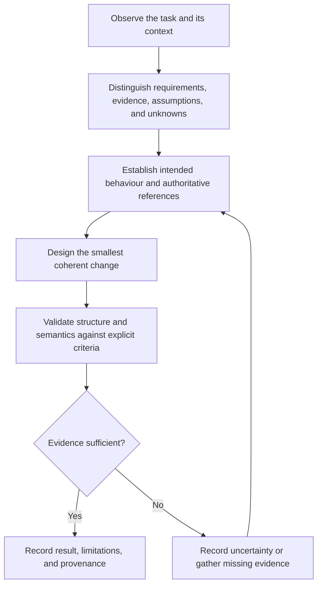

# Skills Development

A reusable framework for developing, extending, reviewing, and validating agent skills without losing the requirements, distinctions, evidence, and observer position that made them coherent.

This repository is independent of any one skills tree. In particular, it does not own or replace the Incus Swagger API skills tree in [`incus-skills/incus-skills`](https://github.com/incus-skills/incus-skills). That project may consume this framework; it remains a separate project with its own purpose and authority.

## What belongs here

- **Collection-level development model** — the distinct movements through which skills are formed, derived, and composed.
- **Development framework** — criteria and method for creating and extending skills.
- **Canonical diagram policy** — normative rules for Mermaid diagrams.
- **Portable diagram-policy skill** — an operational procedure that applies the policy.
- **Contribution and validation practice** — how changes are assessed and how uncertainty is recorded.

## Documents

| Path | Authority and purpose |
|---|---|
| [`DEVELOPMENT_MODEL.md`](DEVELOPMENT_MODEL.md) | Provisional model of context-derived formation, specification-derived development, and third-party capability composition |
| [`SKILL_DEVELOPMENT.md`](SKILL_DEVELOPMENT.md) | Canonical development framework and preserved observer position |
| [`diagram-policy/POLICY.md`](diagram-policy/POLICY.md) | Normative Mermaid diagram requirements |
| [`diagram-policy/SKILL.md`](diagram-policy/SKILL.md) | Portable operational skill implementing the policy |
| [`CONTRIBUTING.md`](CONTRIBUTING.md) | Contributor workflow and review expectations |

The policy defines requirements; the skill operationalizes them. If they conflict, the policy has authority and the conflict must be surfaced rather than silently resolved.

## Development path

This is an orientation diagram, not a substitute for the detailed procedure in [`SKILL_DEVELOPMENT.md`](SKILL_DEVELOPMENT.md).

## Current status

The repository's initial framework and diagram-policy documents are being established. A skill being present or discoverable does **not** mean it has been validated. Validation status must be reported from executed checks and recorded evidence, not inferred from registration.

## Core principle

Preserve reconstructability, not merely the final artifact. A future contributor should be able to recover what problem was being addressed, which distinctions mattered, what evidence supported the design, what remains uncertain, and how to validate the next change.
