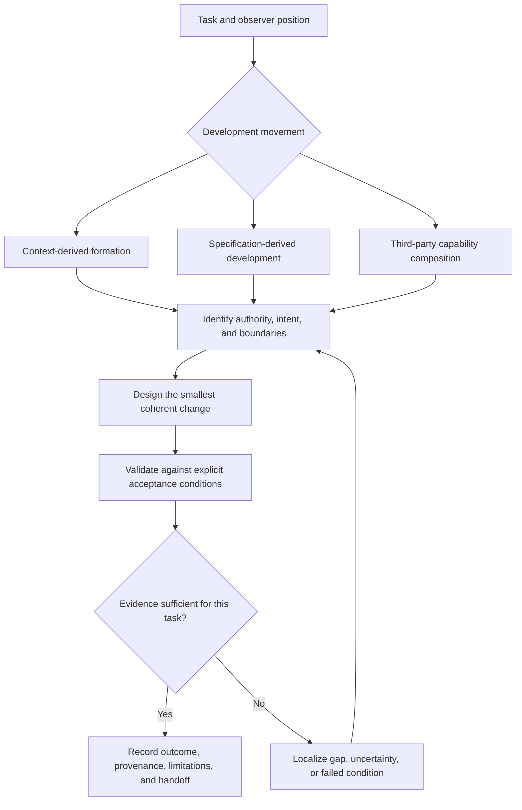

# Skills Development — Project Skill

**Status:** Initial self-contained project skill; provisional and subject to evidence-led revision.

## Purpose

Develop, extend, review, and validate agent skills while preserving the requirements, distinctions, authority, provenance, evidence, and observer position needed to understand and safely revise them.

Use this skill when working on the `incus-skills/skills-development` project or when applying its development method to a skill, collection, or profile composition. It is a project-level operating guide, not a claim that every skill tree must share one architecture.

This project is distinct from the Incus Swagger API skills tree in `incus-skills/incus-skills`. The projects may inform one another, but neither automatically owns or governs the other.

## Current project context

The collection must support multiple development movements:

1. **Context-derived formation:** a prompt or sustained context develops reusable distinctions and procedures that may be stabilized as a skill.
2. **Specification-derived development:** a skill is derived from an identified authoritative specification, such as an API description.
3. **Third-party capability composition:** an existing external skill is assessed and selected, constrained, or composed for a target profile or environment.

These movements are provisional and non-exhaustive. A project may combine them. Do not force every skill through one universal lifecycle.

Across movements, preserve purpose and activation conditions, authority, provenance, boundaries, dependencies and composition, validation evidence, uncertainty, and continuity/handoff.

## Operating principles

- Observe before interpreting; distinguish before classifying; establish relations before synthesizing; record observer position and evidence before presenting conclusions.
- Separate requirements, observations, inferences, assumptions, and unresolved questions.
- Preserve reconstructability, not merely the final artifact.
- Treat the actual source or policy as authoritative only for the claims it defines. A source can be authoritative for one question and insufficient for another.
- A skill being present, discoverable, or syntactically valid does not mean it has been semantically or operationally validated.
- Prefer the smallest coherent change that meets the task's needs. Do not compress away a material distinction, boundary, dependency, failure path, or uncertainty.
- Keep portable behaviour separate from runtime-specific packaging and adapters where that separation is useful.
- Do not silently rename, merge, reorder, simplify, or reinterpret elements when the change alters meaning.
- Use Mermaid for diagrams in this project. Rendering verifies syntax/display only; semantic validation requires comparison with an independently established intended-structure reference.

## Project development map

This diagram is an orientation aid, not a mandatory sequence for every contribution. The applicable development movement determines which authority and checks are relevant.

## Procedure

### 1. Establish the task and entry point

Before editing, identify:

- the task to be completed and its scope;
- the current artifact(s) and revision(s);
- the relevant development movement or combination of movements;
- the expected outcome and acceptance conditions;
- the execution environment and any permissions or constraints;
- what is already known, assumed, missing, or disputed.

If an essential task condition is ambiguous, ask for clarification or record the ambiguity and stop the affected action. Do not silently choose an interpretation that materially changes the result.

### 2. Identify authority and provenance

Determine which source governs each material requirement or claim. Depending on the task, this may include user decisions, source context, an API/specification revision, a canonical project policy, an external skill's actual contents, or observed runtime behaviour.

Record the source and revision where reproducibility matters. Distinguish specification claims from implementation observations and inference. If authorities conflict, name the conflict and its impact; do not silently reconcile it.

### 3. Classify the change

Choose the smallest suitable change type:

- improve an existing skill;
- add a skill with a distinct responsibility;
- revise a canonical policy;
- add or revise a runtime-specific adapter or installation instruction;
- change collection/profile composition;
- add supporting documentation, examples, baselines, or tests without changing skill behaviour.

Do not create a new skill merely because a task has a new name. Do not overload an existing skill when its purpose, authority, or validation boundary would become unclear.

### 4. Design and implement

Make the intended behaviour and boundaries explicit. A substantive skill should make these discoverable, whether as separate headings or compact combined sections:

- purpose, activation conditions, and non-goals;
- governing authority and dependencies;
- required inputs, assumptions, and missing-context behaviour;
- procedure, decision points, expected outputs, and stopping conditions;
- failure, conflict, and unsupported-state handling;
- validation and acceptance criteria;
- portability constraints and runtime assumptions;
- provenance, limitations, maintenance expectations, and handoff.

Use diagrams where relational structure materially helps. Keep diagram source. Do not treat a diagram as self-validating or as a substitute for authoritative prose and test criteria.

### 5. Validate the result

Choose checks appropriate to the task and its risk. Report the dimensions separately where applicable:

- **Structural:** required files, fields, nodes, edges, or sections exist and conform to expected form.
- **Semantic:** relationships and behaviour match the independently stated intent and constraints.
- **Operational:** the skill or procedure was executed in the relevant environment and produced the expected result.
- **Reproducibility:** the source revision, inputs, criteria, and evidence allow another reviewer to repeat the check.

For traversal-based work, do not rely on one successful run. Where behaviour depends on agent inference, evaluate meaningful variation in context and task formulation. Compare task interpretation, reference selection, mandatory checks, acceptance results, and stopping decisions. Different paths can be acceptable; unacknowledged changes to required behaviour are not.

Record which checks actually ran, the evidence observed, checks not run, limitations, and unresolved issues. Never describe a candidate test as passed unless it was executed and the result recorded.

### 6. Decide whether the task is sufficiently complete

A task is sufficiently complete when the defined acceptance conditions are met and the evidence supports that judgement; material limitations and unresolved uncertainties are explicit; and another contributor can reconstruct and verify the result from the recorded sources and evidence.

Sufficiency is task-relative. It does not require resolving every possible uncertainty. It does require distinguishing an actual information gap from an agent's unrecorded assumption, and a successful individual run from evidence of repeatable behaviour.

If evidence is insufficient, localize the failure where possible: task interpretation, authority, reference discoverability, missing procedure, uncovered branch, execution, validation, or stopping decision. Make the smallest change that addresses the demonstrated weakness, or record why more evidence or an authorized decision is needed.

### 7. Leave a handoff

Record:

- what changed and why;
- governing source and policy revisions;
- expected behaviour and acceptance criteria;
- checks actually performed and results;
- unresolved decisions, limitations, and checks not performed;
- the next safe and useful action.

The next contributor should not need to rediscover a material decision that can be preserved concisely. Do not present a conclusion without enough of its supporting path to reconstruct it.

## Structure and refactoring policy

This project skill is deliberately self-contained at this stage. Its current form is an implementation choice, not a claim that a single-file structure is universally best or permanently fixed.

The project must **not** adopt a `SKILL.md` plus associated-reference split solely because that arrangement exists in the Incus skills project or is a familiar convention. The current outstanding Incus investigation asks whether a top-level behavioural contract and Mermaid relational information in `SKILL.md), individually or jointly, can bias traversal toward deterministic-enough behaviour.

Until that experiment produces relevant results, or external evidence establishes behavioural influence in a sufficiently homologous situation, retain the current self-contained project-skill unless a separate demonstrated need justifies a change.

If such evidence becomes available:

1. inspect what was actually tested, including the effective context and consumer path;
2. distinguish the individual effects of the behavioural contract and relational representation from any combined effect;
3. assess the evidence's relevance to this project's tasks and operating conditions;
4. identify which behaviour or maintenance need the proposed split would improve;
5. compare the proposed structure against the current single-file implementation using explicit acceptance criteria;
6. refactor only where the evidence and project needs justify it, preserving provenance and validating the resulting traversal.

The evidence may justify a split, another structure, a limited adaptation, or no structural change. It does not predetermine the answer. Do not retrofit the project to match an experimental outcome without assessing transferability.

## Status language

Use status terms precisely:

- **Draft:** proposed content not yet accepted as a governing baseline.
- **Registered:** present and discoverable.
- **Validated:** specified checks were executed and the evidence/result recorded.
- **Provisional:** assessed against a draft or incomplete reference.
- **Unresolved:** evidence or an authorized decision is insufficient to settle a material question.

Registration is not validation. A hash identifies content, not semantic intent. A successful syntax/render check is not semantic, operational, or reproducibility validation.

## Core completion test

> Given the task's entry point, authoritative sources, and preserved validation record, can another contributor reconstruct what the skill is meant to do, why its boundaries exist, what evidence establishes correctness, what remains uncertain, and how to continue safely?

If not, identify the missing distinction or evidence and address that gap before claiming full completion.
