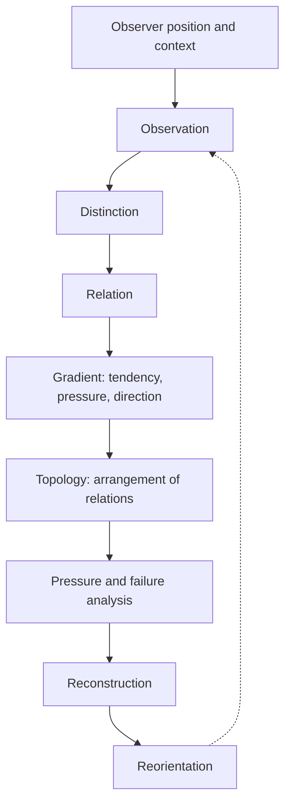

# Skills Development Framework

**Status:** Initial framework; subject to revision through explicit, traceable changes.

## 1. Purpose

This document preserves the development criteria and observer position needed for humans and AI assistants to extend a skills library coherently over time. It is intended to make the reasoning and validation conditions reconstructable, rather than treating current files as self-explanatory or as the only thing worth preserving.

This framework is library-independent. A consuming project retains its own purpose, source authority, API/domain requirements, and governance. Adoption of this framework does not transfer ownership of a consuming project's skill tree to this repository.

## 2. Current observer position

The working position is:

- A skill is an operational artifact induced by a problem, its constraints, its environment, and the available evidence.
- The artifact is not the sole preservation target. Preserve the distinctions, rationale, source references, validation evidence, limitations, and conditions required to reconstruct or safely revise it.
- Visibility precedes commitment. Make assumptions, conflicts, gaps, and uncertainty visible rather than converting them into implicit facts.
- A coherent result is not necessarily a validated result. State what was actually executed and observed.
- A framework should enable future work without forcing every domain into one vocabulary or architecture.

The method is deliberately ordered:

The cycle is a reasoning discipline, not a claim that every project must use these words as its user-facing terminology. The key constraints are: observe before interpreting; distinguish before classifying; establish relations before naming a whole; reconstruct before synthesizing; record observer position before presenting conclusions.

## 3. Distinctions that must remain visible

Do not collapse these distinctions merely to make a document shorter or a workflow look simpler:

| Distinction | Required treatment |
|---|---|
| Requirement vs observation | Requirements state what must hold; observations state what was found. |
| Evidence vs inference | Identify direct evidence separately from interpretation or extrapolation. |
| Known vs assumed vs unresolved | Label uncertainty; do not silently promote an assumption to a requirement. |
| Policy vs procedure | Policy defines normative constraints; a skill or procedure applies them. |
| Canonical source vs installed copy | Record which source governs and how copies are kept compatible. |
| Portable core vs harness adapter | Keep reusable semantics independent of runtime-specific packaging where possible. |
| Registration vs validation | Discoverability proves presence, not correctness. |
| Syntax vs semantics | A document or diagram can parse and still express the wrong relationships. |
| Draft vs approved baseline | Provisional criteria permit provisional checks, not claims of final acceptance. |
| Artifact preservation vs reconstructability | Preserve enough provenance and distinctions to explain and reproduce the reasoning. |
| Lineage vs current sufficiency | Historical origin and present ability to reconstruct are related but not interchangeable. |

When a distinction is not relevant, state that judgement where it affects a decision. Do not omit it simply because it is inconvenient to the current implementation.

## 4. Skill design criteria

Every substantive skill should make the following discoverable. A compact skill may combine sections, but it must not lose the underlying information.

1. **Purpose and activation:** what task it serves, when to use it, and when not to use it.
2. **Authority:** the policies, source documents, API specifications, or user decisions that govern its behaviour.
3. **Inputs and assumptions:** required context, defaults, environmental dependencies, and how missing information is handled.
4. **Procedure:** ordered actions, decision points, expected outputs, and safe stopping conditions.
5. **Failure and conflict handling:** how to expose ambiguity, policy conflicts, failed checks, and unsafe or unsupported states.
6. **Validation:** explicit criteria, tests or comparisons, expected evidence, and how to report partial results.
7. **Portability:** distinguish reusable behaviour from runtime-specific installation or adapter details.
8. **Provenance and maintenance:** version/revision declarations, dependencies, known limitations, and change history where needed.
9. **Handoff:** leave the next contributor a safe next action and enough context to continue without guessing.

Use the smallest coherent design that satisfies these criteria. Avoid duplicating an existing skill's responsibility unless a deliberate boundary is documented.

## 5. Canonical policy and diagrams

The canonical Mermaid requirements are in [`diagram-policy/POLICY.md`](diagram-policy/POLICY.md). The portable operational procedure is in [`diagram-policy/SKILL.md`](diagram-policy/SKILL.md).

All diagrams in this repository's project artifacts, README files, methodology documents, skill documents, and relevant derivatives must use Mermaid markup. ASCII art, Unicode box drawing, and indented pseudo-diagrams are not acceptable substitutes. If Mermaid cannot adequately express a structure, use a table and explain the limitation in prose.

A diagram is not validated merely because Mermaid renders it. Validation must compare its explicit relationships and meaning against an independently established intended-structure reference. Do not use the diagram being tested as the sole source of its own intended meaning.

## 6. Authority and compatibility

Before a skill executes, it must identify its governing policy and check compatibility where the skill declares a policy revision.

- Matching skill and policy revisions: proceed to the task's normal checks.
- Skill revision behind policy: stop the affected operation until the skill is updated or an explicit compatibility decision is recorded.
- Skill revision ahead of policy: stop and verify that the policy source/distribution is authoritative and available.
- Policy missing or revision unreadable: stop the affected operation; compatibility is unverified. Missing policy does not mean there is no constraint.
- Policy and skill conflict: name the conflicting provisions, describe impact, and stop the affected operation until resolved. Unrelated safe work may continue.

Record the exact policy source and revision used. A pinned revision is preferred when reproducibility matters; a floating branch reference alone is not a reproducible dependency.

## 7. Validation and acceptance

Report structural, semantic, operational, and reproducibility status separately where applicable.

- **Structural:** required files, fields, nodes, edges, or sections exist and conform to expected form.
- **Semantic:** the relationships and behaviour match the intended structure and constraints.
- **Operational:** the procedure or skill was actually executed in the relevant environment and produced the expected result.
- **Reproducibility:** the source revision, test inputs, reference criteria, and execution evidence are sufficient for another reviewer to repeat the check.

For each acceptance report, include:
- result and scope;
- criteria/baseline ID, revision, status, and location;
- checks actually performed and evidence observed;
- relevant changes from the baseline and their authorization;
- unresolved ambiguities, limitations, and checks not performed;
- enough provenance to repeat the check.

A hash establishes identity of the hashed content, not the semantic intent of that content. If no structured baseline exists, state the limitation and do not claim full semantic reproducibility.

## 8. Revision and change governance

Changes that alter meaning must be explicit. Do not silently rename, merge, delete, reorder, simplify, or reinterpret elements when that changes a requirement, relationship, boundary, condition, or failure path.

For a substantive change, preserve:
- the reason for change;
- the source or observation motivating it;
- affected distinctions and dependencies;
- expected behaviour before and after;
- validation performed and result;
- unresolved decisions and the next safe action.

When evidence conflicts with an existing model, record the conflict and alternatives. Do not force the evidence into the existing model merely to preserve superficial consistency.

## 9. Extending the library

For each proposed contribution, decide which change is actually needed:

1. improve an existing skill;
2. add a new skill with a distinct responsibility;
3. change a canonical policy;
4. add or revise a runtime-specific adapter or installation instruction;
5. add documentation, examples, baselines, or tests without changing skill behaviour.

Prefer the smallest coherent change that solves the demonstrated problem. Check for existing responsibilities, dependencies, and shared terms before creating a parallel concept. Keep domain-specific assumptions out of the portable core unless they are genuinely universal to the skill.

A new skill should not be created merely because a task has a new name. Conversely, do not overload an existing skill when its purpose, authority, or validation boundary would become ambiguous.

## 10. Self-application and independent validation

This framework and the diagram policy must follow their own requirements. Self-application is useful for finding internal inconsistencies, but it is not sufficient as the only validation: test against independent use cases and consuming-project requirements as well.

For the diagram policy, the initial regression cases are:
- **A — SPEC architecture:** establish an intended-structure reference independently, then compare the actual source.
- **B — RSS loop:** establish an independent reference that includes feedback/cycle semantics, then compare the actual source.

Cases A and B are candidates until their authoritative source, reference, and actual validation evidence have been identified and recorded. They must not be described as passed based on their mention here. Further self-application candidates may include the policy architecture, validation/conflict procedure, and lifecycle/governance procedure; these are also unvalidated until executed and recorded.

## 11. Contributor handoff

A handoff should let the next contributor determine:

- what changed and why;
- which source and policy revisions governed the change;
- which requirements are established and which remain assumptions or unresolved;
- what was actually tested and what the results were;
- which limitations or conflicts remain;
- what next action is safe and useful.

Do not make the next contributor rediscover a decision that can be preserved in a concise record. Do not present a conclusion without enough of its supporting path to reconstruct it.

## 12. Completion criterion

A contribution is complete when its artifacts, authority, compatibility, intended behaviour, validation evidence, limitations, and unresolved decisions are visible at a level proportionate to its risk. Completion does not require every uncertainty to be resolved; it requires uncertainty to be explicit and the result to be safely reconstructable.

The guiding test is:

> Given only the referenced sources and preserved validation record, can another contributor reconstruct what the skill is supposed to do, why its boundaries exist, and what evidence would establish whether a future change remains correct?
