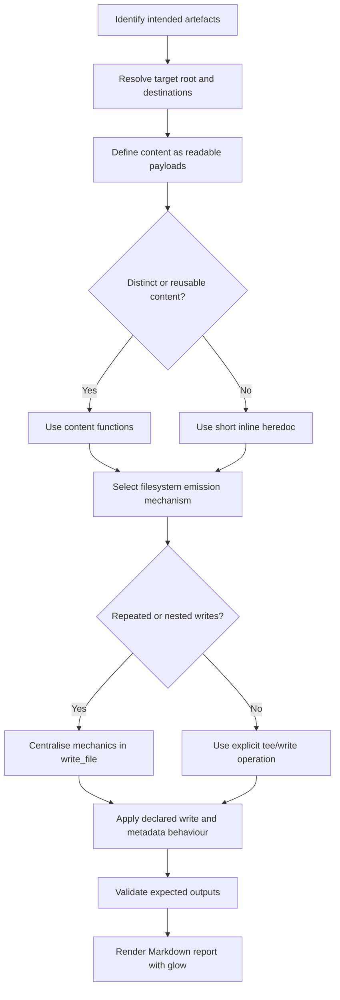
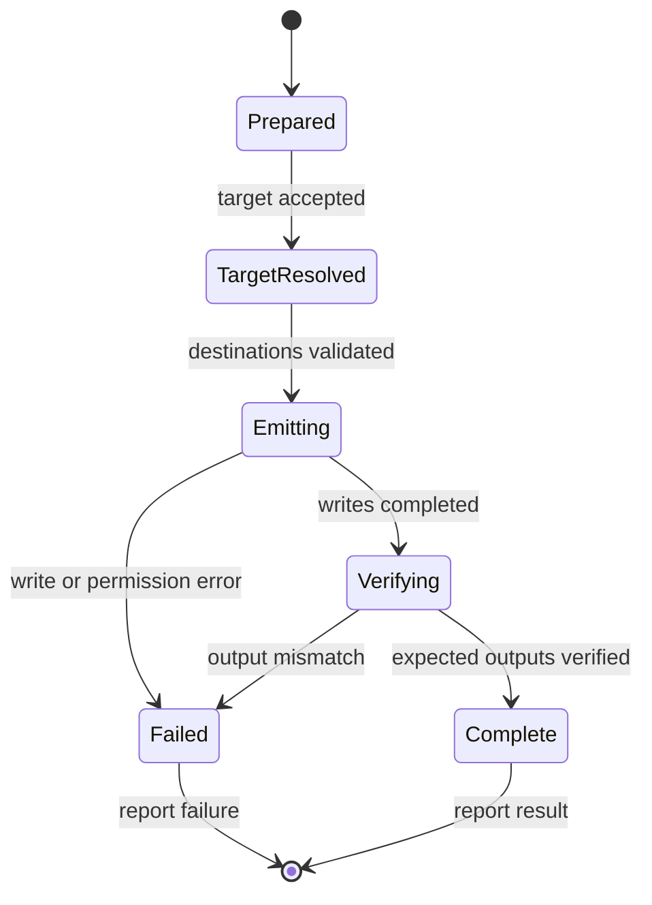

# Heredoc and Content Emission Policy

**Revision:** 2.0.0  
**Status:** Proposed general-purpose baseline  
**Authority:** Normative for shell scripts, skills, and projects that explicitly adopt this policy.  
**Scope:** Representation, construction, filesystem emission, and terminal presentation of multi-line text content, including scripts that generate repository trees and other durable filesystem artefacts.  
**Provenance:** Generalised from the provisioning heredoc policy developed through the Hermes provisioning script series (019–025) and its predecessors. Hermes is the originating context, not the boundary of applicability. The provenance records the supplied development history; it does not independently certify every historical test.

## 1. Purpose

This policy establishes a consistent, readable, and transferable method for representing multi-line content and emitting it to filesystems or terminal output.

It addresses a recurring failure mode in AI-generated scripts: when no convention is provided, agents tend to improvise content construction and presentation through multiple `echo` commands, shell variables, escape sequences, decorative separators, and ad hoc formatting. Those approaches obscure the intended content, mix presentation with operational logic, and make generated scripts harder to review, maintain, and transfer between sessions or environments.

The policy therefore separates three concerns:

1. **Content representation:** express multi-line content as a readable, coherent block, normally a heredoc.
2. **Filesystem emission:** handle destination paths, directory creation, writes, privileges, and metadata through explicit and reusable mechanisms.
3. **Terminal presentation:** represent reports as Markdown and render them through a dedicated renderer, using `glow` as the standard convention.

The policy is not a universal shell style guide. It governs the content-emission concerns within its stated scope when a project or skill adopts it.

## 2. Terms and boundaries

| Term | Meaning |
|---|---|
| **Emitter** | A script or procedure that constructs or updates filesystem artefacts or produces a report. |
| **Emitted artefact** | A file or directory structure produced by an emitter. |
| **Content function** | A descriptively named function whose output is the content payload, normally written as a heredoc. |
| **Filesystem helper** | A reusable function that centralises common path and write mechanics, such as `write_file`. |
| **Terminal report** | Human-facing status, summary, warning, or completion output rendered for terminal reading. |
| **`emit_` script** | A standalone emitter intended to be saved and executed later, including scripts emitted by an AI chat session when direct repository or forge access is unavailable. |

An emitter and its emitted artefacts are distinct. The emitter is executable construction logic; the resulting files are the durable project artefacts. Do not confuse a readable emitter source with proof that its output is correct.

## 3. Normative rules

### P1 — Represent multi-line content as content, not shell decoration

Use heredocs for coherent multi-line text. Do not construct substantial content or reports from sequences of `echo` statements, concatenated strings, ANSI escape sequences, or decorative shell fragments.

The source should make the intended text directly inspectable. Keep presentation markup inside the content block where appropriate, rather than rebuilding it procedurally.

### P2 — Function-wrap distinct or reusable file content

A heredoc whose body represents a conceptually distinct file payload, is substantial, may be reused, or may later be extracted is emitted through a descriptively named content function. The function describes the content; the call site describes the destination and write operation.

```bash
conf_print_example_config() {
  cat <<'CONTENT'
# Example configuration

setting=value
CONTENT
}

conf_print_example_config | write_file "$DEST"
```

The `conf_print_*` prefix is the established convention inherited from the originating policy. Projects may adopt an equivalent descriptive naming convention, but should not mix naming styles within one emitter family without reason.

**Short inline exception:** a very short, one-use heredoc may remain at the write site when a function would add ceremony without preserving a useful content boundary. This exception does not relax quoting, privilege, or overwrite requirements.

### P3 — Keep file-writing mechanics explicit and privilege-safe

The standard file-writing mechanism is `tee` or `tee -a`, normally with output silenced using `>/dev/null`. Use `sudo tee` for privileged destinations. Do not rely on `sudo command > file` to elevate a redirection: the invoking shell performs that redirection before the privileged command executes.

```bash
conf_print_example_config | tee "$DEST" >/dev/null
conf_print_example_config | sudo tee "$ROOT_DEST" >/dev/null
```

A narrowly scoped inline `cat > "$DEST"` may be used for a short, guarded, unprivileged declaration when wrapping it would be pure ceremony. It must not be used to bypass privileged-write handling.

### P4 — Render terminal reports as Markdown through glow

Terminal reports use one Markdown heredoc and one `glow` invocation per report. Do not use multi-line `echo` sequences, hand-built terminal decoration, or ad hoc ANSI formatting for report presentation.

```bash
glow - <<'REPORT'
## Emission complete

- Created: `config/app.conf`
- Created: `scripts/emit_example.sh`
- Result: verified
REPORT
```

The choice of `glow` is deliberate: Markdown provides a structured, portable report source, while `glow` handles terminal rendering. The report remains readable and reusable as ordinary Markdown independently of its rendering.

A runtime adopting the terminal-report convention should make `glow` available. If it is unavailable, report the dependency gap and resolve it explicitly; do not silently fall back to improvised `echo` or decoration. A consuming environment may define an explicit renderer adapter, but the report format remains Markdown.

### P5 — Precompute report state before the report heredoc

Evaluate command substitutions and operational checks before the report heredoc, store their results in descriptively named variables, and interpolate those values into the report only where required. Do not embed command substitutions, pipelines, or operational logic inside the report body.

```bash
if [[ -s "$DEST" ]]; then
  dest_state="present"
else
  dest_state="missing"
fi

# Expansion is required only to insert the precomputed destination and state.
glow - <<REPORT
## Destination check

- Path: $DEST
- State: $dest_state
REPORT
```

This keeps report construction readable and makes state determination independently inspectable. Treat variable interpolation as content insertion, not as a place to perform further work.

### P6 — Quote heredoc delimiters by default

Use a single-quoted delimiter for literal content, for example `<<'CONTENT'` or `<<'REPORT'`. This prevents parameter, command, and arithmetic expansion in the heredoc body.

An unquoted delimiter is permitted only when shell expansion is required to construct the emitted content. Place an adjacent comment naming the required expansion and why it is needed. For non-deterministic substitutions, also state whether regeneration on each run is intended (P10).

```bash
# Literal payload: preserve dollar signs and backticks exactly.
write_file "$DEST" <<'CONTENT'
literal_value="$HOME"
command_example=`do-not-execute`
CONTENT

# Expansion required: insert the precomputed release identifier.
release="stable"
write_file "$DEST" <<EXPANDED
release="$release"
EXPANDED
```

Do not use `<<"EOF"` as an alternative literal-content convention. Use the single-quoted delimiter form consistently.

### P7 — Keep short heredocs short; preserve useful content boundaries

A short heredoc used once may remain inline when it is incidental to the surrounding logic. Wrap content when it is long, interrupts the reader's view of control flow, represents a named artefact, or is likely to be reused, versioned, tested, or independently reviewed.

The approximate ten-line threshold is a reading heuristic, not a mechanical limit. If a reader must scroll through a payload to find the next control-flow statement, introduce a content function.

### P8 — Treat content functions as refactoring seams

A content function can begin in the emitter and later be extracted into a sourced file without changing the write call site. Preserve this seam when content may grow, be shared, versioned, tested, or independently reviewed.

Sourced content functions should have a clear ownership and loading contract. Do not introduce sourcing merely to split a small one-off script into unnecessary files.

### P9 — Separate content definition from filesystem mechanics

Content functions define what is emitted. Filesystem helpers define how it is written. Call sites determine where and under what conditions it is emitted.

Do not make a generic write helper infer content, decide whether an update is safe, or silently choose whether generated values should rotate. Do not duplicate directory creation, privilege selection, and write mechanics across every file when a shared helper is appropriate.

### P10 — Make repeat-execution and generated-value behaviour explicit

For each emitted file, the emitter must make its repeat-execution behaviour clear: create only if absent, replace, append, skip when unchanged, or another explicitly documented operation.

Do not assume that using `tee` makes an emitter idempotent. Truncating and rewriting the same content may be repeatable, but generated content can still change on each run.

For non-deterministic substitutions such as `date`, random values, or UUID generation, state whether regeneration is intended. If the value must remain stable, guard generation or persist/reuse the original value. If rotation is intended, say so explicitly.

### P11 — Centralise recurring filesystem operations in write_file

When an emitter writes multiple files, especially into nested directory structures, use a shared `write_file` helper to centralise recurring filesystem mechanics:

- creation of parent directories;
- normal versus privileged directory creation and writes;
- truncating versus appending;
- consistent output suppression and error propagation.

The helper centralises filesystem commonalities; it does not replace content functions. Content can remain function-wrapped and self-contained while being passed to the helper through standard input.

A reference interface is:

```bash
# write_file [-a] [-s] DEST
#   -a  append (default: truncate)
#   -s  use sudo for parent-directory creation and file writing
# Reads content from stdin.
write_file() {
  local append=0 use_sudo=0

  while [[ $# -gt 0 ]]; do
    case "$1" in
      -a) append=1; shift ;;
      -s) use_sudo=1; shift ;;
      *) break ;;
    esac
  done

  if [[ $# -ne 1 || -z "$1" ]]; then
    printf '%s\n' "usage: write_file [-a] [-s] DEST" >&2
    return 2
  fi

  local dest="$1"
  local parent
  parent="$(dirname -- "$dest")" || return

  if (( use_sudo )); then
    sudo mkdir -p -- "$parent" || return
    if (( append )); then
      sudo tee -a -- "$dest" >/dev/null
    else
      sudo tee -- "$dest" >/dev/null
    fi
  else
    mkdir -p -- "$parent" || return
    if (( append )); then
      tee -a -- "$dest" >/dev/null
    else
      tee -- "$dest" >/dev/null
    fi
  fi
}
```

This is a Bash-oriented reference implementation, not a universal drop-in library. Consumers must validate shell compatibility, `sudo` policy, path assumptions, and failure propagation in their actual execution context. In particular, when content is piped into the helper, the caller must account for producer failures (for Bash pipelines, normally with `set -o pipefail` or an equivalent explicit status check). Do not claim a successful emission if directory creation, content production, or writing failed.

File modes, ownership, and other metadata should be applied explicitly after a successful write, or by a separately documented helper. Do not hide unrelated metadata policy inside `write_file`.

### P12 — Make standalone emit_ scripts reconstructable and safe to execute

When producing a standalone `emit_*` script, particularly as a durable output from an AI chat session, the script must be usable without relying on the originating conversation or undocumented working-directory state.

At minimum, it must:

1. State its purpose and expected output structure.
2. Declare or accept an explicit target root; resolve destinations from that root rather than depending on the caller's current directory.
3. Create required parent directories deterministically.
4. Represent each file payload as readable content, normally a quoted heredoc or a content function.
5. Declare each file's write behaviour (create, replace, append, guarded, or skip-if-unchanged).
6. Apply executable modes and other required metadata explicitly.
7. Fail visibly when a required operation fails; do not continue as though a partial tree were complete.
8. Validate expected output paths and report the result.
9. Avoid writing outside the declared target root. Reject absolute or parent-traversal paths supplied as relative destinations, and do not follow unexpected pre-existing symlink paths when that could escape the target root.
10. Include sufficient usage information to run the script after the chat session has ended.

Do not use `eval` or dynamically assembled shell source as a substitute for explicit content definitions. Do not silently overwrite pre-existing user content: overwrite and append behaviour must be declared by the emitter or selected explicitly by the caller.

The policy does not require every emitter to implement a manifest, checksums, rollback, or a particular command-line interface. Add those mechanisms when the task's requirements justify them, and document their contract.

## 4. Pattern selection

| Pattern | Content definition | Emission mechanism | Use when |
|---|---|---|---|
| **A — short inline heredoc** | At the write site | Direct unprivileged write or helper | Short, guarded, one-use content where a function adds no useful seam |
| **B — function-wrapped content** | Named function in the emitter | `tee` or `write_file` | Self-contained file content that is substantial, named, reusable, or reviewable |
| **C — helper-wrapped heredoc** | At the call site | `write_file` | Short one-off content in a script already using the shared helper |
| **D — sourced content function** | Separate sourced file | `write_file` or `tee` | Long or shared content requiring independent review or versioning |
| **E — standalone emitter** | One or more content functions or manifest-like declarations | Shared filesystem helper and explicit validation | A script that constructs a durable directory tree or repository structure |

Pattern B and Pattern E are complementary: a standalone emitter may define its file payloads through function-wrapped heredocs and use one `write_file` helper for all common filesystem operations.

Decision rule:

> Preserve a named content boundary when the payload is conceptually distinct or may be reused. Centralise filesystem mechanics when repeated writes share the same operational requirements. Use a standalone emitter when the output must be reconstructable and executable independently of the chat or session that produced it.

## 5. Emission lifecycle

The following flow describes the general decision path. It does not require every emitter to implement every optional mechanism.



For a standalone emitter, the execution itself has a lifecycle:



## 6. Applicability and adoption

This policy applies to adopting scripts and procedures that construct multi-line text, write files, build directory structures, generate scripts/configuration, or produce human-facing terminal reports.

It is suitable for repository provisioning, project scaffolding, system configuration, build processes, bootstrap scripts, and standalone `emit_` scripts. The original Hermes provisioning scripts are provenance, not the policy's exclusive domain.

It does not automatically govern projects that have not adopted it. A consuming project should identify the policy revision and source location. A copied or adapted version should preserve provenance and record divergence.

The policy does not override a consuming project's higher-authority security requirements, supported-shell constraints, platform constraints, or explicit filesystem ownership rules. If a conflict arises, identify the provisions and affected operation, then record an authorized compatibility decision before proceeding with the affected pattern.

## 7. Anti-patterns

- **Multi-line echo construction:** replace with a readable heredoc and the appropriate renderer or write mechanism.
- **Hand-built terminal decoration:** use Markdown rendered through `glow`.
- **Operational commands inside report heredocs:** precompute state and interpolate the resulting values.
- **Unquoted heredocs for literal content:** use a single-quoted delimiter.
- **Unjustified expansion:** document why an unquoted delimiter is necessary.
- **Privileged shell redirection:** use `sudo tee` or the privileged branch of `write_file`.
- **Duplicated directory and write mechanics:** centralise recurring operations in `write_file`.
- **Content hidden inside a generic helper:** keep payload definitions readable and separately addressable.
- **Unspecified overwrite behaviour:** declare create/replace/append/guard/skip semantics.
- **Assumed idempotence:** distinguish repeatable writes from stable generated values.
- **Emitter dependent on chat context:** make the standalone script self-contained and document its target root and usage.
- **Unvalidated partial output:** verify expected paths and propagate failures.

## 8. Rationale summary

| Property to preserve | Policy mechanism |
|---|---|
| Content remains directly readable in source | P1, P2, P7 |
| Content has a stable extraction and reuse seam | P2, P8 |
| Filesystem mechanics remain consistent across a tree | P9, P11 |
| Privilege boundaries are respected | P3, P11 |
| Reports have consistent, transferable formatting | P4, P5 |
| Report logic remains separate from report presentation | P5 |
| Literal payloads are not accidentally expanded | P6 |
| Repeat-execution behaviour is predictable | P10, P12 |
| AI-generated emitters remain useful after the chat ends | P12 |
| Partial or failed emission is not reported as success | P11, P12 |

## 9. Validation expectations

A policy adoption or implementation review should distinguish:

- **Structural:** required files, functions, delimiters, comments, and call-site patterns are present.
- **Semantic:** each heredoc is classified correctly; expansions are intentional; destinations and write behaviour match the declared intent.
- **Operational:** representative writes and reports execute in the target shell and environment.
- **Reproducibility:** shell and utility versions, inputs, target root, privilege setup, and observed outcomes are recorded.

At minimum, test the applicable cases:

1. Literal content containing dollar signs, backticks, quotes, and backslashes.
2. A justified expansion and a precomputed report value.
3. Append and truncate behaviour.
4. User-owned and privileged destination paths where applicable.
5. Parent-directory creation for both privilege modes.
6. Stable generated content under a guard.
7. Intentional rotation.
8. Markdown report rendering through `glow`.
9. Failure propagation for directory creation, content production, and writes.
10. Standalone emitter execution from a working directory other than the repository root.
11. Target-root containment and rejection of unsafe relative paths.
12. Verification of expected files and executable modes.

A syntax check is not operational validation. A successful write in one environment does not establish compatibility in every target environment. Record checks not run and unresolved platform assumptions.

## 10. Revision history

| Revision | Summary |
|---|---|
| 2.0.0 | Generalises the provisioning heredoc policy into a reusable content-emission policy; retains the `glow` reporting convention, function-wrapped content, and `write_file` centralisation; adds standalone emitter requirements. |
