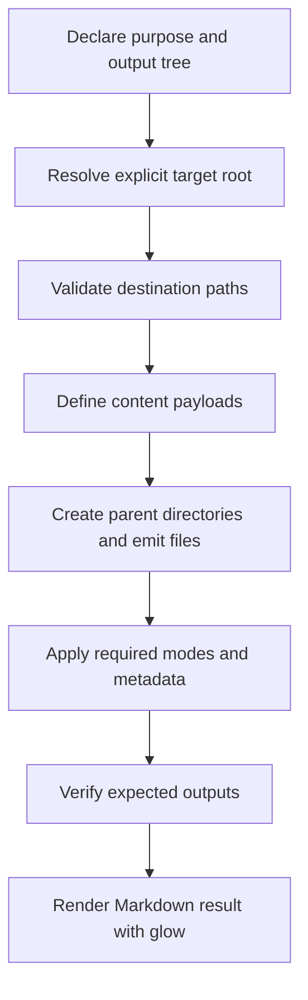
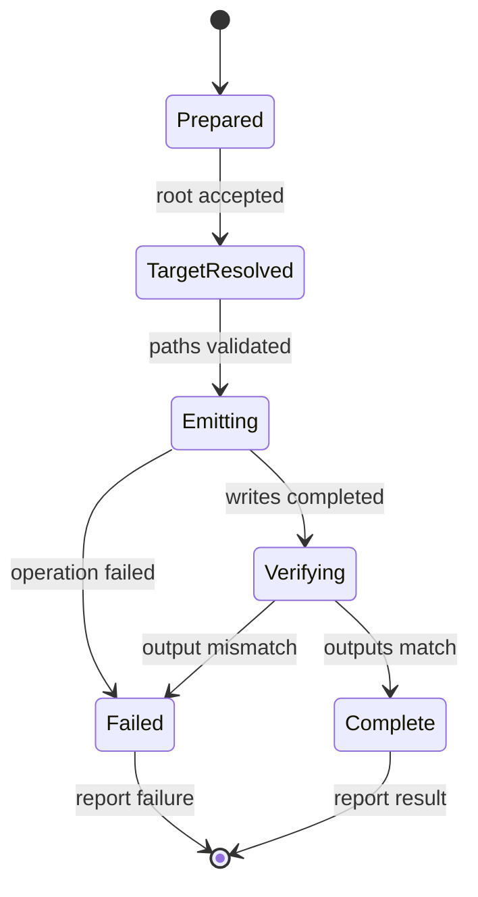

# Heredoc and Content Emission Skill

## Quick procedure

1. Identify whether the output is a filesystem artefact, terminal report, or standalone emitter.
2. Read the governing [POLICY.md](POLICY.md) and verify the declared revision.
3. Define the content as readable heredocs; use content functions for distinct or reusable payloads.
4. Select explicit filesystem mechanics; centralise recurring directory and write operations in `write_file`.
5. Use Markdown rendered by `glow` for terminal reports.
6. Make overwrite, expansion, privilege, and repeat-execution behaviour explicit.
7. Validate the output and report what was actually checked.

Do not begin by inventing a sequence of `echo` commands or formatting fragments.

## 1. Purpose and compatibility gate

This skill operationalises the canonical [Heredoc and Content Emission Policy](POLICY.md). The policy is normative; this skill is procedural.

**Policy compatibility gate:** this skill declares policy revision `2.0.0`. Before use, inspect the policy and verify its revision. If the policy is missing or unreadable, stop the affected operation and report compatibility as unverified. If the skill is behind the policy, stop until updated. If the skill declares a later revision than the available policy, verify the authoritative distribution. If policy and skill conflict, identify the conflicting provisions and impact, then stop the affected operation until an authorized resolution is recorded.

## 2. Classify the emission target

Determine which output type is being produced:

| Output type | Required representation | Destination mechanism |
|---|---|---|
| File content | Readable heredoc; content function when distinct/reusable | `tee` or `write_file` |
| Nested directory/file tree | Explicit destinations and per-file write behaviour | Shared `write_file` helper |
| Terminal report | Markdown heredoc | `glow` |
| Standalone `emit_*` script | Self-contained shell source with explicit target root and usage | Script creates and validates its declared output tree |

A single script may produce both filesystem artefacts and a terminal report. Keep those output channels separate.

## 3. Define content

### 3.1 Prefer literal heredocs

Use a quoted delimiter unless shell expansion is required:

```bash
conf_print_example() {
  cat <<'CONTENT'
# Example

path = "$HOME"
literal = `not a command`
CONTENT
}
```

If expansion is necessary, use an unquoted delimiter and place an adjacent comment explaining the exact required expansion. Precompute command results before the heredoc.

### 3.2 Use content functions when they preserve a useful boundary

Use a descriptive content function for payloads that are named, substantial, reusable, independently reviewable, or likely to be extracted.

The function defines content; the call site defines destination and operation:

```bash
conf_print_app_config() {
  cat <<'CONTENT'
# Application configuration
mode=production
CONTENT
}

conf_print_app_config | write_file "$TARGET_ROOT/etc/app/app.conf"
```

Do not wrap every tiny one-use heredoc mechanically. Use the short inline exception only when the content is incidental and the function would add no useful seam.

## 4. Select filesystem emission mechanics

### 4.1 One-off writes

Use `tee` for ordinary writes and `sudo tee` for privileged destinations. Do not use privileged command redirection as a substitute.

### 4.2 Repeated writes and nested structures

When a script populates multiple files or nested directories, use one shared `write_file` helper for recurring directory creation, privilege selection, append/truncate behaviour, and write handling.

Keep content functions separate from this helper. The helper consumes content on standard input; it does not define or transform the payload.

Before adopting a helper implementation, verify its argument contract, shell assumptions, privilege behaviour, and failure propagation. For content pipelines in Bash, account for failures in both the content producer and the writer (normally with `set -o pipefail` or explicit status handling).

Apply file modes and ownership explicitly after successful writes unless a separate, documented helper owns that responsibility.

### 4.3 Declare repeat-execution behaviour

For every emitted file, decide whether the emitter creates, replaces, appends, guards, or skips it. Do not assume `tee` makes an operation idempotent.

Guard non-deterministic values when they must remain stable. Document intentional rotation.

## 5. Produce terminal reports

Use one Markdown heredoc and one `glow` invocation per report:

```bash
glow - <<'REPORT'
## Files emitted

- `etc/app/app.conf`
- `scripts/emit_app.sh`

**Result:** verified
REPORT
```

Do not construct reports from multi-line `echo` calls, ANSI sequences, or ad hoc decorative variables. Precompute state before the heredoc. If variables must be interpolated, document the required expansion and use the corresponding unquoted delimiter.

Make `glow` available in the target environment. If it is unavailable, report the dependency gap and resolve it explicitly; do not silently improvise a different presentation convention.

## 6. Build standalone emit_ scripts

A standalone `emit_*` script is a durable handoff artefact. It must remain understandable and executable after the originating AI chat has ended.

### Required construction sequence



The script should:

1. State its purpose, usage, and expected output tree.
2. Accept or declare an explicit target root; do not depend on the caller's current directory.
3. Resolve all output destinations from that root.
4. Reject absolute or parent-traversal paths when destinations are declared relative to the root.
5. Avoid following unexpected symlink paths that could escape the target root.
6. Define file content as readable heredocs, preferably through named content functions for distinct payloads.
7. Use a shared `write_file` helper when multiple writes share filesystem mechanics.
8. Declare create/replace/append/guard/skip behaviour; do not silently overwrite existing user content.
9. Apply executable bits and other required metadata explicitly.
10. Stop or report failure when a required operation fails; do not report a partial tree as complete.
11. Verify expected files and report the result.
12. Include enough usage information to run the script independently of the chat.

Do not use `eval` or dynamically assembled shell source to construct payloads. A manifest, checksum set, rollback mechanism, or elaborate CLI is optional unless the task requires it.

### Execution lifecycle



## 7. Validate and report

Report the validation dimensions separately:

- **Structural:** required functions, files, delimiters, and paths exist.
- **Semantic:** payloads, destinations, overwrite behaviour, and expansions match the intended result.
- **Operational:** the script was executed in the target environment and produced the expected files.
- **Reproducibility:** inputs, shell/tool versions, target root, permissions, and results are recorded sufficiently for another contributor to repeat the check.

At minimum, where applicable, verify literal special characters, justified expansion, parent-directory creation, privileged writes, append/truncate semantics, failure propagation, target-root containment, expected file paths, and executable modes.

A syntax check is not an operational test. Do not claim checks that were not run. Record limitations and unresolved environment assumptions.

## 8. Completion and handoff

A content-emission task is complete only to the level supported by its evidence. Preserve:

- the emitter source and emitted file paths;
- the target root and write behaviour;
- policy revision and relevant dependencies;
- checks actually run and their results;
- failures, limitations, and checks not performed;
- the next safe action if the output is incomplete.

The next contributor should be able to inspect the source, understand the output structure, and reproduce or safely rerun the emission without reconstructing the original chat.
