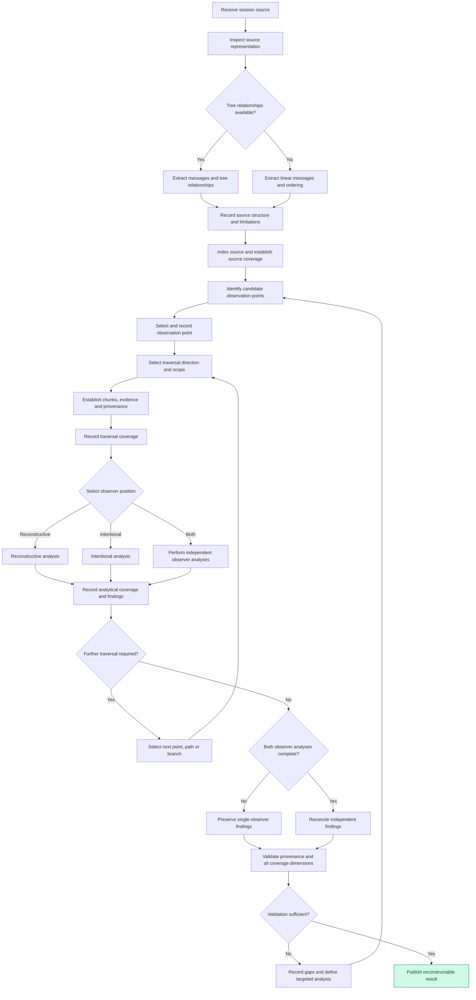
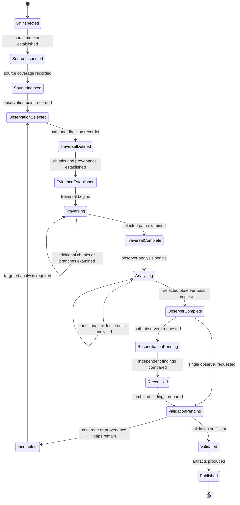

# Session Thread Mining

## Quick procedure

1. Identify the source representation and the structural information actually available.
2. Select a useful observation point and traversal direction.
3. Chunk the material to expose turn-by-turn interactional development; retain enough evidence to interpret each chunk.
4. Apply the requested observer position(s) independently.
5. Reconcile independent findings only when both analyses are requested.
6. Produce a concise analytical account that supports renewed engagement, noting material uncertainties and access limitations.

Do not mistake a source's available structure for the interaction itself. Use structural detail where it materially improves analysis; do not pursue exhaustive indexing or coverage for its own sake.

## 1. Purpose and scope

This skill provides a method for chunking and analysing AI conversation sessions so a new session can engage with related topics from an informed but necessarily different observer position. It reconstructs interactional development, not the original session state.

It supports two independent observer positions:

1. **Reconstructive observer:** treats the session as evidence of how ideas,
   distinctions, decisions and outcomes developed.
2. **Intentional observer:** treats the eventual outcome as a candidate
   expression of an intention that the session may have been progressively
   attempting to communicate to the AI. Earlier messages and subsequent
   corrections are examined as parts of a possible correction-design process.

The observers are complementary, not interchangeable. Their findings must
remain separate until an explicit reconciliation stage.

The skill accepts that extraction into a new session may flatten or lose context. It does not attempt to eliminate that loss, reproduce the original observer position, or transfer the original interaction. A later message, correction, branch or formulation may provide a useful starting point for analysis.

### 1.1 Scope boundary: analytical reconstruction, not preservation or handoff

Session-thread mining is not a preservation discipline, continuity system or handoff protocol. It does not aim to retain or transfer the original interaction, reproduce its context, or reinstate its observer position.

Chunking reconstructs the turn-by-turn development and effects of interaction. This differs from treating the chat history as a single document for summarisation or thematic extraction: it makes responses, corrections, emerging distinctions, changes of direction and abandoned lines of inquiry available for renewed analysis.

The new session is a distinct observer. Some flattening, transformation and loss of context are accepted. The resulting account is an analytical basis for engaging with related topics; it does not confer continuity of identity, context or responsibility between sessions.

The objective is interactional reconstructability sufficient for renewed engagement, not preservation of the original interaction.

### 1.2 Design constraint: efficiency relative to outcome

Prefer the least procedural and contextual overhead that produces a useful analytical result. Add detail only when it materially improves renewed engagement enough to justify its cost. Aim for sufficiency, not exhaustiveness; define essential distinctions and safeguards, but leave routine judgement to the agent. Do not compress away interactional development necessary to understand how the discussion changed.

### 1.2 Foundational principles

| Principle | Operational consequence |
|---|---|
| Observation precedes interpretation | Establish source structure before assigning meaning. |
| Distinction precedes classification | Record distinctions before categorising them. |
| Evidence precedes synthesis | Material analytical claims should be supportable from the available source evidence. |
| Structure informs analysis | Use message and branch relationships when available and materially relevant; do not treat their retention as an end in itself. |
| Observation position matters | Record where analysis begins and what it can see. |
| Reconstruction precedes reconciliation | Complete independent observer analyses before combining them. |
| Correction is evidence | Treat corrections as evidence of requirements, constraints or interpretive failures. |
| Uncertainty is preserved | Do not turn inference into historical fact. |
| Renewed engagement is the outcome | Include enough evidence and context for a new observer to understand the interactional development relevant to the task. |

## 2. Source recognition and structural preservation

Before chunking, identify the source representation and establish its available
structural information.

### 2.1 Source representations

**Linear representation**

A plain-text or Markdown representation in which messages appear primarily in
sequence. It may preserve message boundaries and speaker labels, but can omit
or flatten reply relationships, branch ancestry and alternate continuations.

**Tree-preserving representation**

A representation that retains message identities and relationships, such as a
ChatGPT emailed conversation export when its conversation-tree relationships
are present. It may expose message identity, parent/reply relationships,
branch membership, alternative continuations, ordering, timestamps and other
metadata.

Do not assume every export preserves every relationship. Inspect the actual
representation and record what is available.

### 2.2 Source inspection

Record:

- Source filename or identifier and format.
- Available message boundaries and speaker/role information.
- Message identifiers, if present.
- Parent and reply relationships, if present.
- Branch relationships, if present.
- Ordering information and timestamps, if present.
- Missing, ambiguous or flattened structural information.

Do not infer missing parent relationships from textual proximity alone. Also
record whether a relationship is absent from the underlying source, unavailable
through the current access mechanism, or simply not yet retrieved.

### 2.3 Representation handling

| Source property | Linear source | Tree-preserving source |
|---|---|---|
| Message boundaries | Extract where available | Extract and retain identifiers |
| Ordering | Preserve source order | Preserve available ordering metadata |
| Parent relationships | Record as unavailable unless explicit | Extract where available |
| Branch relationships | Record as unavailable unless explicit | Extract where available |
| Chunk boundaries | Primarily message or range based | Message, range, branch or subtree based |
| Traversal | Primarily forward/backward through sequence | Forward, backward and branch traversal |
| Context recovery | Use neighbouring source ranges | Use graph relationships and relevant neighbouring context |

A linear source is not invalid because it lacks tree information. Its
limitations must remain visible.

### 2.4 Agent-accessible sources

The source need not be presented as a single file or export. In an agentic
environment, the material may be exposed through the capabilities available
to the agent. Examples include:

1. **Direct linear material:** pasted text, Markdown, transcripts or message
   sequences supplied in the current context.
2. **Structured conversation exports:** exported histories that retain
   message identifiers, parent-child relationships, branches or metadata.
3. **Imported conversation archives:** histories transferred into another
   agent environment and exposed through a memory provider or other plugin.
4. **Knowledge-store representations:** conversations or extracted messages
   held in an Obsidian vault, an LLMWiki-style knowledge base or another
   retrieval-backed store.
5. **Agent-accessible sources:** material discoverable and retrievable through
   tools, plugins, connectors or memory interfaces, where the agent must
   establish how to locate and navigate it.

These are examples of access and representation conditions, not supported
integration specifications. The skill does not prescribe a parser, adapter,
plugin, storage schema or retrieval API. It defines the analytical method and
the requirements by which the available representation is assessed.

#### Separate access, representation and underlying source

| Concern | Meaning | Required treatment |
|---|---|---|
| Source access | How the agent obtains or navigates material in its environment | Discover and describe the capabilities actually available |
| Available representation | The content, identities, metadata and relationships exposed to the agent | Inspect and record what is actually observable |
| Underlying source | The original conversation, archive or knowledge material from which the representation derives | Do not make claims about inaccessible structure or completeness |
| Session mining | The observation, traversal, chunking and analysis method | Apply the same evidence and provenance discipline across environments |

The analytical method is invariant; the access mechanism may vary. The skill
governs session mining and establishes requirements for assessing the
available representation. It does not prescribe source access.

#### Retrieval and transformation safeguards

1. Source material may be accessed directly, through files, through retrieval
   tools, through memory providers or through other agent capabilities.
2. A retrieval result is not automatically a complete representation of the
   underlying source.
3. Search results and retrieved fragments may expose selected content without
   exposing original message identity, ancestry, branch membership or
   neighbouring context.
4. Distinguish information that is **unavailable through the current
   interface** from information that is **not yet retrieved or examined**.
   Do not mark material absent merely because a query did not return it.
5. Do not infer that an underlying conversation was linear because the
   current retrieval interface exposes isolated messages or flattened text.
   Record that the interface has not exposed the relevant tree structure.
6. Record import, indexing, transformation, summarisation, chunking or
   retrieval steps when they affect content, identity, ordering, provenance
   or structural interpretation.
7. Where possible, retain links from retrieved material to its original
   source identifiers and locations. If those links are unavailable, record
   the provenance limitation rather than inventing a mapping.
8. Treat retrieval scope, query terms, filters, pagination, result limits and
   access restrictions as potential coverage constraints. Record them when
   they materially limit what could be observed.
9. Do not treat a memory summary, semantic-search result or knowledge-store
   excerpt as an exhaustive source inventory unless the system provides
   evidence that it is exhaustive.

A retrieval miss establishes only that the current access operation did not
return the material. It does not establish that the material does not exist.

#### Agent-access assessment

Before mining agent-accessible material, record:

| Field | Description |
|---|---|
| Access mechanism | File access, direct context, search, memory provider, plugin, connector or other tool |
| Accessible scope | Which archive, vault, collection, conversation or namespace can be queried |
| Discovery method | How source items are located |
| Retrieval method | How messages or fragments are obtained |
| Navigation capability | Whether parent, child, sibling, branch or adjacent-item traversal is supported |
| Identity and provenance | Identifiers and original source locations exposed |
| Completeness guarantees | Any documented guarantee about exhaustive enumeration; otherwise record as unknown |
| Retrieval constraints | Query limits, filters, pagination, truncation or access restrictions |
| Transformations | Known import, indexing, summarisation or normalization steps |
| Unavailable capabilities | Relationships or source regions the interface does not expose |

Do not assume a memory provider or knowledge store offers exhaustive search,
stable message identity, chronological ordering or graph navigation. Verify
each capability from the actual interface and its observed behaviour.

### 2.5 Structural integrity

When a tree-preserving source is available:
### 2.4 Structural integrity

When a tree-preserving source is available:

1. Retain original message identifiers.
2. Retain parent-child relationships.
3. Retain branch identity, or reconstruct it only when the source supports it.
4. Distinguish message order from reply relationships.
5. Preserve sibling branches rather than silently choosing one.
6. Record missing or ambiguous relationships.
7. Never silently convert a tree into a linear narrative.

Tree relationships can clarify interactional development. Consider them when they matter to the selected analysis; exhaustive structural preservation is not required.

## 3. Observation-point selection

The analyst may begin from any useful point in the source. Record the
observation point before traversal and interpretation.

### 3.1 Candidate observation points

| Candidate | Analytical value |
|---|---|
| Initial user request | Establishes the initial problem or instruction. |
| Assistant interpretation | Exposes how the AI understood the preceding request. |
| User correction | Exposes an interpretive deficiency, missing distinction or constraint. |
| Branch point | Exposes a divergence in possible interpretations or approaches. |
| Rejected alternative | Helps identify excluded interpretations and boundaries. |
| Later formulation | Provides a potentially stabilised expression of the intended outcome. |
| Final artifact or outcome | Provides a useful starting point for reverse interpretation. |

A branch is not automatically a rejected direction. Do not infer rejection
without evidence.

### 3.2 Observation-point record

| Field | Description |
|---|---|
| Observation ID | Unique identifier for the analysis position. |
| Source reference | Original message identifier or source range. |
| Selection rationale | Why this point was selected. |
| Available ancestry | Parent messages and recoverable context. |
| Available descendants | Subsequent messages and continuations. |
| Available branches | Sibling or alternative paths. |
| Missing context | Relationships or material that cannot be recovered. |
| Observer position | Reconstructive, intentional or both. |
| Traversal plan | Forward, backward, branch or combined. |

Do not treat a selected observation point as the beginning of the conversation.
It is the beginning of a particular analysis.

## 4. Traversal modes

Traversal direction and observer position are independent choices.

### 4.1 Forward traversal — emergence

Start at an earlier observation point and follow subsequent material.

Ask:

- What was introduced?
- What distinctions emerged?
- What relationships were established?
- What changed?
- What was corrected or constrained?
- What eventually stabilised?
- What remains unresolved?

Forward traversal is useful for reconstructing the development of an idea,
specification or outcome.

### 4.2 Backward traversal — reconstruction

Start at a selected later point and work towards its ancestors or preceding
source material.

Ask:

- What conditions produced this formulation?
- Which earlier messages does it depend on?
- Which corrections or decisions led to it?
- What assumptions does it rely on?
- Which distinctions were previously absent?
- What evidence is needed to reconstruct the path to this point?

Backward traversal is especially useful when a later formulation is more
coherent or informative than the original request.

### 4.3 Branch traversal — alternatives

Start at a selected branch point and inspect alternative continuations.

Ask:

- What alternative interpretations were explored?
- Which alternatives were retained or abandoned?
- What distinguished the branches?
- Did a correction apply to one branch or to the shared conversation?
- Did an alternative expose a requirement not visible in the eventual path?
- Was an apparent decision actually made, or merely left unexplored?

Record branch provenance and its relationship to the selected point.

### 4.4 Combined traversal

A mining operation may combine directions:

- Backward to reconstruct the conditions of a selected formulation.
- Forward to examine what that formulation subsequently changes.
- Across branches to identify alternatives and divergent interpretations.

Record each traversal independently so findings can be traced to the path that
produced them.

## 5. Observer positions

The two observers use different starting assumptions and analytical questions.

### 5.1 Observer A — Reconstructive

**Starting position:** The available session material is evidence from which the
development of an outcome must be reconstructed.

Primary question:

> Given the available source material, what can be reconstructed about how
> the ideas, distinctions, decisions and corrections developed?

Responsibilities:

1. Identify the expressed content of each chunk.
2. Record distinctions and relationships.
3. Identify changes between relevant messages.
4. Distinguish proposals, decisions, corrections and unresolved positions.
5. Identify what the source establishes and what it does not establish.
6. Reconstruct dependencies between messages and outcomes.
7. Preserve historical uncertainty.

Do not treat the final outcome as proof that all earlier material was
deliberately directed towards it.

**Expected output:** An evidence-based reconstruction of development, including
provenance, transitions, unresolved matters and confidence limitations.

### 5.2 Observer B — Intentional

**Starting position:** The eventual outcome is treated as a candidate expression
of an intention that the session may have been progressively attempting to
communicate to the AI.

Primary question:

> If the eventual outcome expresses an intention being communicated through
> the session, what do the messages and corrections reveal about the
> specification needed to make that intention intelligible?

Interpret the session as a possible correction-design process, and test that
interpretation against the evidence.

Responsibilities:

1. Identify the candidate intended outcome from the selected formulation or
   artifact.
2. Identify distinctions necessary to express that outcome.
3. Examine earlier messages as potentially incomplete expressions of the
   intention.
4. Interpret corrections as possible evidence of missing, misunderstood or
   insufficiently constrained information.
5. Identify recurring interpretive failures.
6. Extract requirements for AI comprehension and behaviour.
7. Identify what the AI would need to preserve to avoid repeating those
   failures.
8. Distinguish explicit historical intention from intention inferred
   retrospectively.
9. Record evidence that weakens or contradicts the continuity hypothesis.

Examples:

| Source event | Intentional interpretation |
|---|---|
| Repeated correction | May identify a persistent interpretive failure. |
| Rejected formulation | May reveal a boundary around the intended concept. |
| Clarification | May expose a distinction the original instruction did not communicate. |
| Methodological correction | May specify how the AI should reason, not merely what it should conclude. |
| Later formulation | May make explicit an intention that earlier messages expressed incompletely. |
| Correction to a correction | May refine the requirements for communicating the intended meaning. |

**Expected output:** A candidate intention model, communication requirements,
correction history, interpretive failure patterns and explicit uncertainty.

### 5.3 Historical-intent safeguard

Intentional continuity is an interpretive hypothesis, not a historical fact.
The observer must investigate whether the session supports it.

It may conclude:

- "This correction reveals a constraint necessary to express the eventual
  intention."

It must not automatically conclude:

- "The user explicitly intended this exact constraint from the beginning."

Record the difference between:

- Explicitly expressed intention.
- Intention inferred from the stabilised outcome.
- Intention inferred from corrections.
- Intention that remains uncertain.
- Evidence inconsistent with or weakening the continuity hypothesis.

This safeguard prevents retrospective interpretation from manufacturing
historical certainty.

### 5.4 Observer comparison

| Dimension | Reconstructive observer | Intentional observer |
|---|---|---|
| Starting position | Source evidence | Candidate expression of intended outcome |
| Primary question | How did this emerge? | What was this trying to communicate? |
| Correction interpretation | Change in development | Possible refinement of specification |
| Earlier material | Evidence of its contemporary state | Potentially incomplete expression of intention |
| Primary output | Reconstructed development | Candidate intention and communication requirements |
| Main risk | Losing the intended whole through chronology | Projecting final understanding backwards as historical fact |

Neither observer may silently modify the other's findings.

## 6. Evidence establishment and chunk formation

Chunk evidence and provenance must be established before observer analysis.
A chunk is a bounded unit of source evidence, not a summary or an
interpretation.

### 6.1 Chunking objectives

Chunks must be:

- Traceable to original source locations.
- Large enough to preserve local meaning.
- Small enough to support focused analysis.
- Explicit about missing context.
- Reusable across observer positions and traversal modes.
- Stable enough to be referenced by subsequent analysis artifacts.

### 6.2 Boundary selection

Prefer boundaries based on:

- Message boundaries.
- Changes in subject or concern.
- Introduction of a new distinction.
- A correction or response sequence.
- A branch point.
- A transition in the development of an artifact.
- A coherent local interaction.

Do not split a correction from the message or interpretation it addresses when
doing so would destroy the relationship necessary to understand it.

If a chunk requires context from outside its boundaries, record the required
context references. Do not silently enlarge the chunk or copy context without
recording its provenance.

### 6.3 Chunk record

| Field | Description |
|---|---|
| Chunk ID | Stable identifier. |
| Source ID | Source artifact identifier. |
| Source range | Original line range, message IDs or equivalent. |
| Message IDs | Included message identities, when available. |
| Parent references | Relevant parent messages. |
| Branch references | Relevant branch relationships. |
| Boundary rationale | Why the chunk begins and ends where it does. |
| Context dependencies | References to necessary material outside the chunk. |
| Source coverage status | Complete, partial, unavailable or ambiguous for this chunk. |
| Evidence record | Relevant source passages or message references, without interpretation. |

### 6.4 Chunk identity and observation context

Chunk identity belongs to the source, not to an observer.

The same chunk may be examined under different observation points, traversal
directions, observer positions and analytical questions. Do not create a new
source chunk merely because its interpretation changes. Maintain separate
analysis records linked to the same chunk identifier.

**Keep these boundaries distinct:**

- Chunk boundaries determine how source material is divided.
- Observation boundaries determine which source relationships are relevant
  from a particular position.

These must not be conflated.

## 7. Analytical scope

When scope needs to be reported, distinguish these three dimensions. They are practical indicators of what the analysis covered, not completeness guarantees or preservation obligations.

### 7.1 Source coverage

**Question:** Which parts of the supplied source have been identified and
accounted for in the structural index and chunk inventory?

Record:

- Total identifiable source messages or ranges.
- Indexed messages or ranges.
- Chunked messages or ranges.
- Excluded material and rationale.
- Missing, malformed or ambiguous source regions.

A source can have complete source coverage even when only a small portion has
been traversed or analysed.

### 7.2 Traversal coverage

**Question:** Which parts of the source have actually been examined from a
particular observation point and traversal direction?

Record traversal coverage per observation point and path:

- Observation ID.
- Traversal direction.
- Messages, chunks, ancestors, descendants or branches visited.
- Relevant relationships followed.
- Available but unvisited branches or ranges.
- Traversal stopping point and reason.

Traversal coverage is position-dependent. A message may be in source coverage
but outside the ancestry, descendants or branches examined from a particular
observation point.

### 7.3 Analytical coverage

**Question:** Which source chunks or evidence units have received a particular
observer's analysis?

Record analytical coverage per observer:

- Observer position.
- Chunks or evidence units analysed.
- Chunks only partially analysed.
- Chunks not analysed.
- Analysis status and completion criteria.
- Findings linked to evidence references.

A chunk can be traversed without receiving a full analysis. A source can be
fully indexed and a traversal fully completed while analytical coverage
remains partial.

### 7.4 Coverage report

| Coverage dimension | Unit of accounting | Required report |
|---|---|---|
| Source | Messages, source ranges and indexed chunks | Accounted for, excluded, missing or ambiguous |
| Traversal | Messages, chunks and graph relationships visited per observation/path | Visited, unvisited, inaccessible and stopping reason |
| Analytical | Chunks/evidence units per observer | Analysed, partial, not analysed and rationale |

Do not report a single undifferentiated "coverage percentage" unless its unit,
scope, denominator and dimension are explicit.

## 8. Dual analysis and reconciliation

Complete selected observer analyses independently before comparing findings.

### 8.1 Independent analysis

For every selected chunk:

1. Refer to the established source evidence and provenance.
2. Apply the reconstructive observer, if selected.
3. Apply the intentional observer, if selected.
4. Preserve findings separately.
5. Record unresolved questions and confidence limitations.
6. Do not reconcile prematurely.

If only one observer is requested, do not invent the other observer's
findings. Record that the second analysis was not performed.

### 8.2 Reconciliation categories

| Category | Meaning |
|---|---|
| Agreement | Both observers support the same finding. |
| Complementarity | Each observer contributes a different aspect of the same issue. |
| Tension | Their interpretations differ without being directly contradictory. |
| Contradiction | Their findings cannot both be accepted as stated. |
| Unresolved inference | Evidence is insufficient to decide between interpretations. |
| Observer limitation | A finding is visible only from a particular observation position. |
| Provenance gap | The source cannot establish the relationship required by the interpretation. |

Do not force all findings into agreement.

### 8.3 Reconciliation output

The combined analysis should preserve:

- Reconstructed development.
- Candidate inferred intention.
- Explicitly documented corrections.
- Inferred communication requirements.
- Stable distinctions and constraints.
- Abandoned or alternative branches.
- Unresolved conflicts.
- Historical uncertainty.
- Provenance and observation position.
- Source, traversal and analytical coverage.

The combined account is not a replacement for the independent analyses. It
is an additional artifact that relates them.

## 9. Operational workflow

This flowchart describes the procedure and its decision paths. Evidence
establishment and provenance recording occur before observer selection.

### 9.1 Analysis lifecycle

This state diagram describes the status of an analysis, not its execution order.

## 10. Analysis outputs

Use only the outputs needed to make the analysis useful and intelligible. The following are possible forms, not a mandatory artifact package.

| Artifact | Purpose |
|---|---|
| Source assessment | Records source representation, completeness and limitations. |
| Structural index | Records messages, ranges, parent relationships and branches. |
| Chunk index | Defines stable chunk boundaries and references. |
| Observation register | Records selected observation points and rationale. |
| Traversal register | Records paths, directions, branches and traversal coverage. |
| Evidence register | Records chunk evidence and provenance before interpretation. |
| Reconstructive analysis | Records the source-led reconstruction. |
| Intentional analysis | Records candidate inferred intention and communication requirements. |
| Cross-observer comparison | Records agreements, tensions and contradictions. |
| Integrated reconstruction | Combines findings while preserving provenance. |
| Coverage and validation report | Separately records source, traversal and analytical coverage. |

### 10.1 Source assessment

State what source material was supplied, which representation was used, whether
the source is complete or partial, which structural relationships are
available, which relationships have been lost or flattened, and which
assumptions are necessary for analysis.

### 10.2 Structural and chunk index

Make it possible to locate every chunk in the original source. For
tree-preserving sources, retain message identifiers and relationships. For
linear sources, retain line ranges and message boundaries where available.

### 10.3 Observer analysis artifacts

Each analysis must identify:

- Observation point.
- Traversal path and direction.
- Observer position.
- Chunks and evidence units examined.
- Evidence references.
- Findings and inferences.
- Unresolved matters.
- Analytical coverage and limitations.

### 10.4 Integrated reconstruction

Distinguish:

1. What the source explicitly establishes.
2. What can be reconstructed from source relationships.
3. What is inferred about the intended outcome.
4. What corrections reveal about AI communication requirements.
5. What remains uncertain or contradictory.

## 11. Quality and validation requirements

### 11.1 Provenance validation

For every material analytical claim, verify:

- Is there an identifiable source reference?
- Does the referenced source actually support the claim?
- Is the claim explicit, reconstructed or inferred?
- Has a relationship been assumed that the source does not establish?
- Has context been copied or compressed without retaining its origin?

### 11.2 Coverage validation

Verify the three coverage dimensions independently:

**Source coverage**
- All supplied source ranges have been accounted for.
- Excluded ranges have an explicit reason.
- Structural and chunk indexes represent the supplied material accurately.

**Traversal coverage**
- The selected observation point is recorded.
- Traversal paths and directions are identifiable.
- Visited and unvisited branches/ranges are distinguished.
- Stopping points and reasons are recorded.

**Analytical coverage**
- Observer position is recorded for each analysis.
- Analysed, partially analysed and unanalysed chunks are distinguished.
- Both observer positions were applied independently when requested.
- Reconciliation is not claimed unless both requested analyses are complete.

### 11.3 Interpretive validation

Check for:

- Premature compression.
- Semantic gravitation.
- Representation substitution.
- Summary collapse.
- Provenance loss.
- Position drift.
- Retrospective certainty.
- Branch omission.
- Confusion between correction and historical intent.
- Confusion between traversal and analysis.
- Confusion between capability availability and execution isolation.

### 11.4 Renewed-engagement test

A new session should be able to use the analytical account, without pretending to inherit the original context, to answer:

1. What source material was examined?
2. Where did each finding originate?
3. Which observation points were selected?
4. Which traversal paths were followed?
5. Which observer position produced each interpretation?
6. What was explicitly expressed?
7. What was inferred?
8. What source material was indexed, traversed and analysed?
9. Which findings remain unresolved?
10. Does the account provide enough grounding to engage with the related topic while making material uncertainty visible?

If not, add only the context or evidence needed to improve that engagement.

## 12. Diagram policy

All diagrams in this skill and its derivative artifacts MUST use Mermaid
markup. This skill declares diagram-policy revision `2.2`; verify the
governing policy before authoring or changing diagrams.

### Rules

1. **Mermaid only.** No ASCII art, Unicode box-drawing, or indented
   pseudo-diagrams. If a structure cannot be expressed adequately in Mermaid,
   express it as a table and note the limitation in prose.

2. **Choose the diagram type by concern.**
   - Use `flowchart` for a process, workflow or decision sequence.
   - Use `stateDiagram-v2` for a lifecycle, entity state or event-driven
     transition.
   - Do not use a flowchart to model states and transitions, or a state
     diagram to model a sequential process. If both concerns are material,
     split them into separate diagrams.

3. **Decision nodes are explicit.** In Mermaid flowcharts, represent decisions
   as diamond nodes using `{"..."}` syntax. Connect each decision to
   explicitly labelled outcome edges.

4. **Cycles are explicit edges.** If a process returns to a prior node, draw
   the return edge.

5. **Edge labels carry conditions and outcomes.** Write
   `D -->|amend| E`, not `D --> E (amend)`.

6. **Distinguish edge semantics.**
   - `-->` for flow or transition edges.
   - `-.-` for observational or relational associations that do not
     represent execution transitions.
   - `-.->` for directional observational relationships that do not
     represent execution transitions.

7. **Node labels carry node properties.** Put node properties in the node
   label. Put diagram commentary in surrounding prose.

8. **Use subgraphs for boundaries.** Use labelled Mermaid `subgraph` blocks
   for phases, scopes, system boundaries or boundary axes.

9. **Styling is semantic, not decorative.** Use Mermaid `style` directives
   only to identify:
   - Error paths or error states: red fill.
   - Terminal states: grey fill.
   - The primary output: green fill.

   Do not style decision nodes or intermediate states as if they were
   terminal. Essential meaning must remain clear without colour.

10. **One diagram per concern.** Review diagrams with more than approximately
    15 nodes for separation when they combine independently understandable
    concerns. The routing-graph exception in the canonical policy applies
    only to the complete task-to-action path; it does not authorize unrelated
    concerns.

11. **Source is canonical.** Mermaid source is the canonical diagram artifact.
    Rendered PNG/SVG images do not replace or supersede the source.

12. **Validate semantics, not just syntax.** Compare nodes, edges, direction,
    labels, outcomes, cycles, boundaries and invariants against an
    independently established intended structure.

13. **Preserve meaning across edits.** Do not silently repair, simplify,
    rename, merge, reorder or remove structures if that changes meaning.
    Proposed semantic changes require explicit authorization and rationale.

14. **Make the source independently interpretable.** Do not rely on colour,
    layout or surrounding prose alone to convey essential relationships.

### Rationale

Mermaid represents diagrams as structured graphs with nodes, edges, labels,
branches and cycles. Its source is more amenable to machine inspection and
extraction than text-annotated ASCII diagrams, while its rendered form remains
readable to humans.

The policy treats the diagram as both a visual representation and a
structured source artifact. Explicit graph structure improves inspectability
but does not, by itself, guarantee correct interpretation. Selecting the
correct diagram type is part of semantic clarity.

## 13. Operating constraints and failure prevention

### 13.1 Do not

- Treat a plain-text source as if it retained conversation-tree structure.
- Treat a retrieval result as an exhaustive source representation without evidence.
- Treat a retrieval miss as proof that source material does not exist.
- Infer that the underlying source is linear because an access interface exposes only linear fragments.
- Conflate unavailable information with information not yet retrieved.
- Assume chronological sequence is the only valid traversal.
- Assume the final outcome proves historical intention.
- Interpret every correction as evidence of a consciously held earlier
  specification.
- Treat every abandoned branch as rejected.
- Merge independent observer analyses prematurely.
- Convert an inference into an explicit source claim.
- Discard unresolved tensions for the sake of a coherent narrative.
- Change source material while extracting or chunking it.
- Silently repair missing or ambiguous relationships.
- Treat a summary as a substitute for source evidence.
- Treat source coverage as evidence of traversal or analytical coverage.
- Treat traversal coverage as evidence of analytical coverage.

### 13.2 Common failure modes

| Failure | Consequence | Prevention |
|---|---|---|
| Linearisation of a tree | Loss of branch and ancestry information | Preserve structural index |
| Retrieval-as-source assumption | Selected fragments mistaken for the complete archive | Record access scope and completeness guarantees |
| Interface/source conflation | Access limitations mistaken for original source properties | Separate underlying source from available representation |
| Retrieval absence assumption | Unreturned material treated as nonexistent | Distinguish unavailable from not yet retrieved |
| Chronological-only analysis | Missed reverse and branch insights | Select observation points |
| Premature summarisation | Loss of distinctions and corrections | Evidence-first chunking |
| Retrospective projection | False historical certainty | Intentional-observer safeguard |
| Observer contamination | One interpretation shapes the other | Independent analysis |
| Branch collapse | Alternative interpretations disappear | Explicit branch traversal |
| Provenance loss | Findings cannot be checked | Stable source references |
| Chunk fragmentation | Context needed for interpretation is lost | Record context dependencies |
| Coverage collapse | Indexed, traversed and analysed material are conflated | Three-dimensional coverage report |
| False reconciliation | Contradictions become invisible | Preserve reconciliation categories |

## 14. Completion criteria

A session-mining operation is complete when it has produced an account sufficient for its intended renewed engagement, with material limitations made clear. Exhaustive source accounting, traversal or artifact production is not required.

| Requirement | Completion condition |
|---|---|
| Source recognition | Access mechanism, available representation, underlying-source limits and transformations recorded |
| Structural awareness | Relevant available relationships considered |
| Source scope | Relevant source material identified; material gaps noted |
| Observation selection | Observation point and rationale recorded |
| Traversal | Selected directions, paths and traversal coverage documented |
| Evidence establishment | Chunks have stable identifiers and source references |
| Analytical coverage | Analysed, partial and unanalysed chunks recorded per observer |
| Reconstructive analysis | Completed when requested |
| Intentional analysis | Completed when requested |
| Independence | Observer findings remain separately identifiable |
| Reconciliation | Completed when both observers are requested |
| Evidence grounding | Material claims supportable from available source evidence |
| Validation | Reconstructability and uncertainty assessed |

A single-observer analysis can be complete within its requested scope. It must
not be presented as a completed dual-observer analysis.

## 15. Core methodological statement

> Examine a conversation as a sequence of interactions whose effects develop
> through responses, distinctions, corrections and changes of direction.
> Chunking makes that development available to a new observer, who may begin
> from any useful point and examine it forward, backward or across branches.
>
> The new observer does not inherit the original session's position or context.
> The method accepts loss and transformation, using enough source evidence to
> support useful renewed engagement without turning analysis into preservation
> or handoff.

The governing measure is efficiency relative to outcome: retain or add only
what materially improves the new session's ability to engage with the subject.
